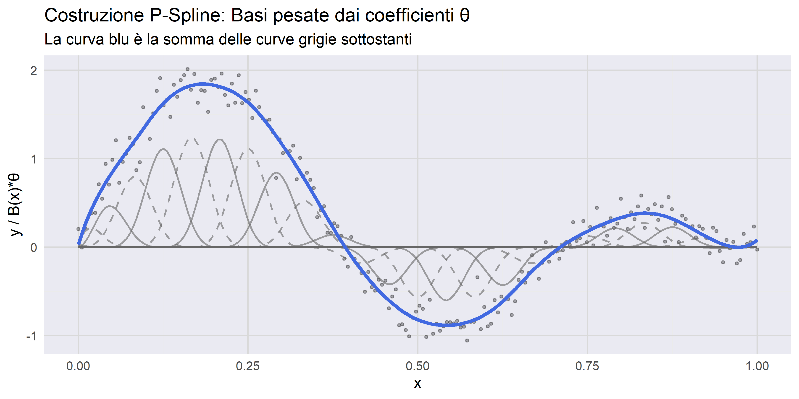
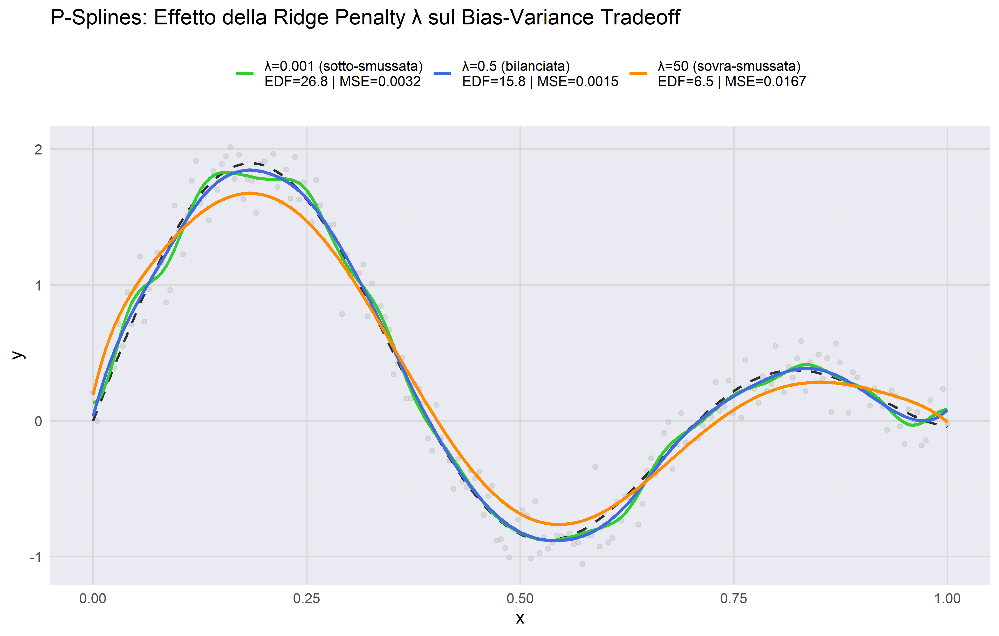
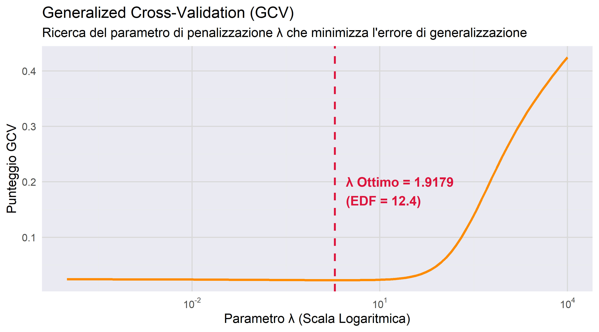
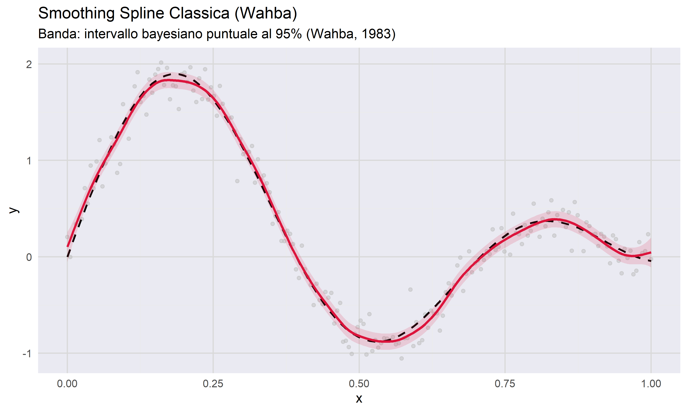

# Smoothing Splines and P-Splines: Bias–Variance and GCV

An educational R implementation of two penalised regression smoothers: the classical
**smoothing spline** (Wahba) and **P-splines** (Eilers & Marx). It shows how a roughness
penalty trades bias for variance, and how **Generalized Cross-Validation (GCV)** picks
the penalty automatically.

## Setup

Synthetic data, $n = 200$, $x \in [0,1]$:

$$
y = \sin(2\pi x) + 0.5x^2 + \sin(10x) + \varepsilon, \qquad \varepsilon \sim \mathcal N(0, 0.15^2).
$$

## Method

**Smoothing spline.** `smooth.spline(x, y, spar = 0.6)`. With `spar` fixed the fit is
a linear smoother $\hat y = S y$, so the script builds $S$ explicitly and draws a pointwise
95% **Bayesian interval** (Wahba, 1983): $\hat f(x_i) \pm 1.96\,\hat\sigma\sqrt{S_{ii}}$,
with $\hat\sigma^2 = \lVert y - \hat y\rVert^2 / (n - \operatorname{tr} S)$.

**P-splines.** A cubic B-spline basis $B$ on 25 equally spaced knots, with a
second-order difference penalty on adjacent coefficients:

$$
\hat\theta = \arg\min_\theta \lVert y - B\theta\rVert^2 + \lambda \lVert D_2 \theta\rVert^2
= (B^\top B + \lambda D_2^\top D_2)^{-1} B^\top y .
$$

The hat matrix is $H_\lambda = B(B^\top B + \lambda D_2^\top D_2)^{-1}B^\top$ and the
effective degrees of freedom are $\mathrm{EDF} = \operatorname{tr} H_\lambda$.

**GCV.** $\lambda$ is chosen on a log grid $10^{-4}\dots10^{4}$ by minimising

$$
\mathrm{GCV}(\lambda) = \frac{\tfrac1n \lVert y - H_\lambda y\rVert^2}{\left(1 - \mathrm{EDF}/n\right)^2}.
$$

## Figures

| | |
|---|---|
|  |  |
| Fitted P-spline as a sum of weighted B-spline basis functions ($\lambda = 0.5$) | Under-, well- and over-smoothed fits ($\lambda$ = 0.001, 0.5, 50) with EDF and MSE |
|  |  |
| GCV score over $\lambda$ and the selected optimum | Smoothing spline with 95% Bayesian band |

## Reproduce

```r
install.packages(c("ggplot2", "scales"))   # 'splines' ships with R
```

```bash
Rscript SL_HW2.R
```

The script regenerates all four PNG files in the repository root.

## References

- G. Wahba. *Bayesian "confidence intervals" for the cross-validated smoothing spline.* JRSS-B, 1983.
- P. Craven, G. Wahba. *Smoothing noisy data with spline functions.* Numerische Mathematik, 1979.
- P. H. C. Eilers, B. D. Marx. *Flexible smoothing with B-splines and penalties.* Statistical Science, 1996.
